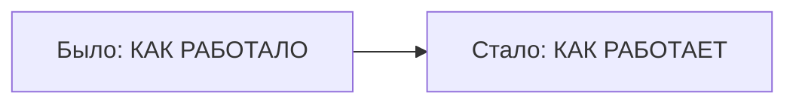

<!-- Правила для автора (в страницу не попадают)
1. Страница отвечает на один вопрос: что сделано и как этим пользоваться. Устройство кода — ссылкой на справку.
2. Предложение до 25 слов. В списке «Что изменилось» не больше пяти пунктов.
3. Только факты из плана, диффа и файлов, которые ты сам открыл.
4. Схема одна, до 10 узлов: что было и что стало либо путь запроса.
5. Команды запускаются как есть.
6. Поле checks заполняется обязательно: по нему страницу проверяет читатель без контекста проекта.
-->

# <Что сделано>

## Зачем

<Одно-два предложения: какую задачу это решает и для кого.>

## Что изменилось

- <изменение, заметное пользователю или разработчику>
- <изменение>

## Схема

## Как пользоваться

1. <шаг>
2. <шаг>

Проверить: `<команда или действие>` → <что должно получиться>.

## Ограничения и что дальше

- <чего это не делает>
- <что осталось на потом>
