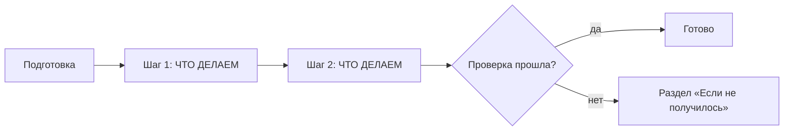

<!-- Правила для автора (в страницу не попадают)
1. Одна страница — одна задача. «Почему так устроено» — ссылкой на страницу-объяснение.
2. Предложение до 25 слов. Один шаг — одно действие.
3. Каждая команда запускается как есть. Переменные задаются в «Подготовке», внутри блоков нет «подставьте нужное».
4. После каждого шага написано, что разработчик должен увидеть.
5. Нет слов «просто», «легко», «очевидно».
6. Схема одна, до 10 узлов.
7. Поле checks заполняется обязательно: по нему страницу проверяет читатель без контекста проекта.
-->

# Как <получить результат>

**Результат:** <что будет работать в конце, одно предложение>.
**Время:** <N минут>. **Нужны права:** <какие>.

## Когда это нужно

<Ситуация в одном-двух предложениях. Если задача другая — ссылка на соседнюю инструкцию.>

## Схема



## Подготовка

- Установлено: <инструмент и версия>
- Доступы: <куда и какой>
- Переменные:

```bash
export SERVICE=<имя сервиса>
```

## Шаги

### 1. <Глагол и объект>

```bash
<команда>
```

Должно получиться: `<строка вывода или состояние>`.

### 2. <Глагол и объект>

```bash
<команда>
```

Должно получиться: `<строка вывода или состояние>`.

## Проверка

```bash
<одна команда, которая подтверждает результат>
```

Ожидаемо: `<что выведет>`.

## Если не получилось

| Что видите | Причина | Что сделать |
|---|---|---|
| `<текст ошибки>` | <причина> | <действие> |

## Как откатить

1. <шаг>

## См. также

- Справка: <ссылка на сгенерированную справку>
- Объяснение: <ссылка на страницу «почему так»>
