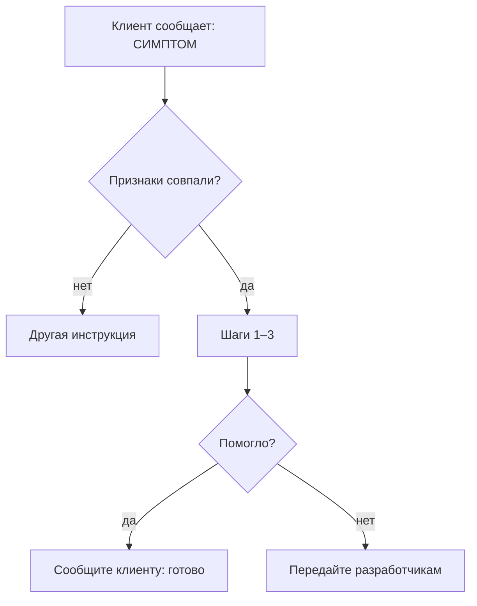

<!-- Правила для автора (в страницу не попадают)
1. Заголовок — словами клиента: что он видит или о чём сообщает.
2. Предложение до 15 слов. Один шаг — одно действие на экране.
3. Без жаргона разработки: нет слов «деплой», «эндпоинт», «под», «бэкенд», «откат», «логи».
   Незнакомое слово объясняется в том же предложении.
4. Названия кнопок и разделов — точно как на экране, в «кавычках».
5. После каждого шага написано, что должно появиться на экране.
6. Командной строки и базы данных здесь нет. Если без них никак — это уже передача разработчикам.
7. Схема одна: развилка «проверил — помогло или не помогло».
8. Поле checks заполняется обязательно: по нему страницу проверяет читатель без контекста проекта.
-->

# <Что видит клиент> — что делать

**Коротко:** <что это за ситуация и чем закончится инструкция, два предложения>.
**Время:** <N минут>. **Клиенту ждать на линии:** <нужно или не нужно>.

## Как узнать эту ситуацию

- Клиент говорит: «<типичная фраза>»
- На экране: <что видно> — <скриншот>
- Это другой случай, если <признак>. Тогда откройте <ссылка на другую инструкцию>.

## Схема

## Что сказать клиенту сразу

> «<готовая фраза: что происходит и сколько ждать>»

## Шаги

1. Откройте «<раздел>» → «<пункт>».
   На экране появится: <что>.
2. Нажмите «<кнопка>».
   На экране появится: <что>.
3. <Действие>.
   На экране появится: <что>.

## Как понять, что помогло

<Один признак, который видит сотрудник или клиент.>

## Если не помогло — передайте разработчикам

Передавайте, если: <условие 1>; <условие 2>.

Приложите:

- номер клиента или обращения (например, лицевой счёт)
- время, когда клиент столкнулся с проблемой
- скриншот экрана
- какие шаги из этой инструкции уже сделаны

Куда: <канал или очередь в трекере>.

## Что сказать клиенту в конце

> Если помогло: «<фраза>»
>
> Если передали разработчикам: «<что будет дальше и когда ждать ответ>»
